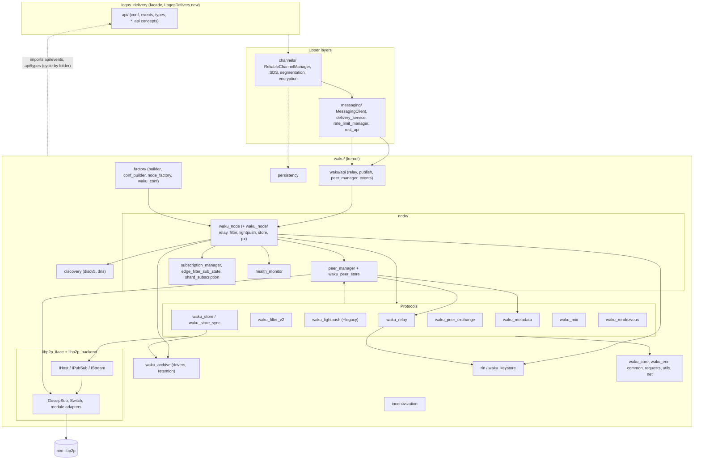
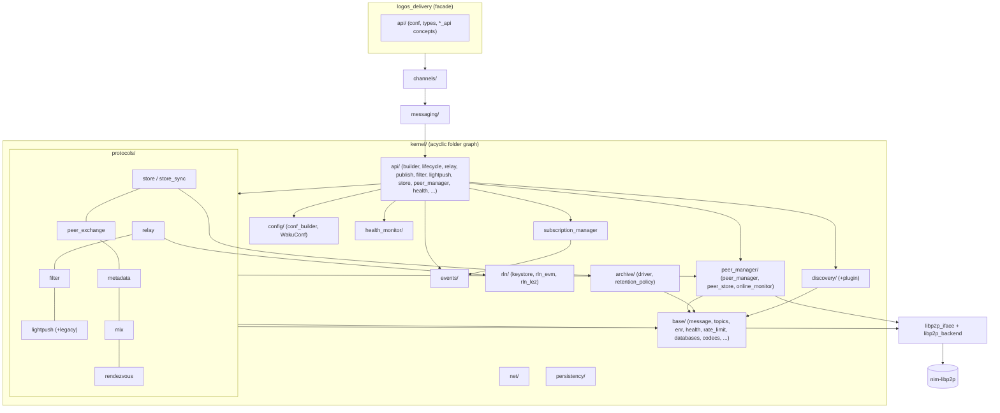

# Component diagrams (Mermaid sources for Miro)

## 1. master (`logos_delivery/waku/`)

## 2. refactor/kernel-single-file (`logos_delivery/kernel/`)

Differences vs master: `waku/` renamed `kernel/` with `waku_` prefixes dropped, `node/` + `factory/` folded into `api/` and `config/`, `common/core/enr/utils/requests` merged into `base/`, protocols grouped under `protocols/`, events moved down, folder import graph made acyclic (addresses #4273 concerns 1 and 5).
